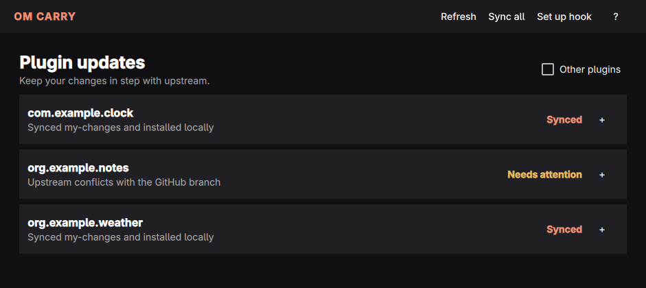
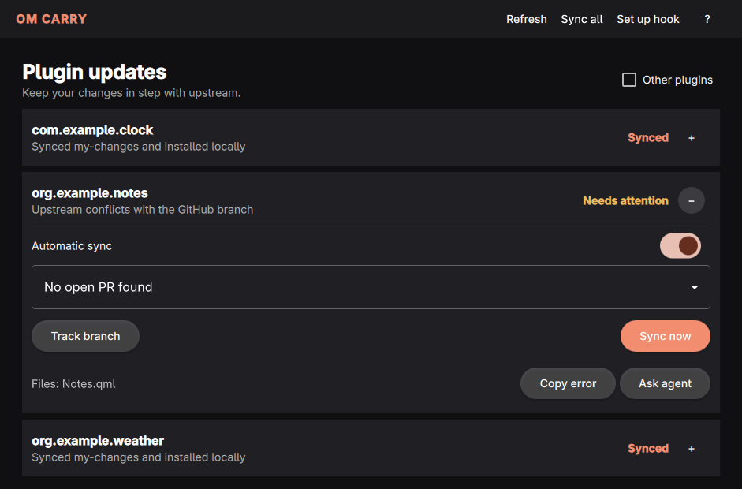

<div align="center">

# Om Carry

**Your changes. Upstream updates. Both, together.**

[](https://omarchy.org/)
[](https://github.com/keylimesoda/omacarry/releases/latest)
[](https://github.com/keylimesoda/omacarry/actions/workflows/test.yml)
[](#how-sync-works)

Keep your Omarchy shell plugins up to date while carrying your own changes.



*Screenshots use fictional plugins and repositories.*

</div>

## The situation

You make a useful change to an Omarchy plugin and open a pull request—or keep
the change on a personal GitHub branch. Meanwhile, the plugin's upstream keeps
moving. You want the new fixes and features **and** your own change in the app
on your desktop.

Om Carry keeps the branches together. When you run an Omarchy update, it checks
the upstream project, brings its changes into your GitHub branch, and installs
the resulting branch locally. Your change travels along with the updates.

```text
Upstream updates  →  Your GitHub branch  →  Your installed plugin
```

## What it does

- **Finds your plugins.** Discovers Git-managed Omarchy shell plugins and looks
  for your open GitHub PRs. PRs with the same head and base are grouped.
- **Works without a PR.** Explicitly track a personal GitHub branch for a
  longer-term change you want to keep using.
- **Syncs when you update.** The post-update hook checks enabled plugins; use
  **Sync now** whenever you want to run it yourself.
- **Protects your work.** Sync prepares the update in a temporary checkout and
  stops for conflicts, uncommitted files, or unpublished local commits. Pushes
  use an explicit Git lease, and a safety ref records the previous local tip.
- **Makes failures actionable.** See the last error, copy diagnostic context,
  or send it to your configured Omarchy agent.

<details>
<summary><b>See a sync that needs attention</b></summary>
<br>



</details>

## Get started

You'll need **Omarchy**, **Python 3**, **Git**, **GitHub CLI** (`gh`), **Qt 6** (Qt Quick and Wayland),
**qmake6**, **make**, and a **C++ compiler**. Sign in with `gh auth login`, configure your
Git identity, and make sure Git can push to your fork.

```sh
git clone https://github.com/keylimesoda/omacarry.git ~/Work/omacarry
cd ~/Work/omacarry
./bin/omacarry-install
```

Open **Om Carry** from your app launcher. Expand a plugin to select its PR or
choose **Track branch**. Automatic sync can be enabled or paused per plugin.

The installer adds a launcher and registers an Omarchy post-update hook. Both
point to this checkout, so keep it in place or rerun the installer if you move
it. To install only the launcher, use `./bin/omacarry-install --no-hook`. You
can also open the app directly with `./bin/omacarry gui`.

## How sync works

1. Find the selected open PR or explicitly tracked personal branch.
2. Fetch its GitHub branch and upstream base, then prepare and validate the
   update in a temporary checkout. Merge-shaped histories stay merges;
   linear histories are rebased.
3. Push the updated GitHub branch with a lease. If that succeeds, update and
   install the local plugin and ask the shell to rescan it.

Om Carry stops when it needs your help—for example, if a replay conflicts, the
local checkout contains unpublished work, or the remote branch changes during
the push. If GitHub updates but local installation fails, the result says so.
The hook runs when a confirmed `omarchy update` reaches its post-update step; it
doesn't continuously check for updates in the background.

**Scope:** GitHub-hosted, Git-managed Omarchy shell plugins. Separate
development checkouts currently need manual attention and aren't overwritten.
The post-update hook and `carry` command use remote-first sync; lower-level
legacy Git commands remain available through `./bin/omacarry --help`.

## Keyboard shortcuts

| Key | Action |
| --- | --- |
| `?` | Show shortcuts |
| `Ctrl+R` | Refresh the plugin list |
| `Q` | Quit |

The interface follows the Omarchy accent and window rounding. It follows the
Omarchy language setting, with Danish translations for interface labels and
English fallback for other languages and engine messages.

## Update or remove

Pull updates in the checkout. Rerun the installer if its location changes.

To remove the launcher, delete `~/.local/share/applications/omacarry.desktop`.
To stop automatic sync, remove
`~/.config/omarchy/hooks/post-update.d/post-update-omacarry.hook`. Plugin state
and logs remain in `~/.config/omacarry/` until you choose to remove them.

## Development

```sh
python3 -m unittest discover -s tests -v
```

GUI and desktop integration are checked inside an isolated `omabox` desktop.
